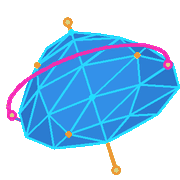
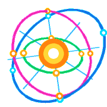
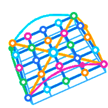
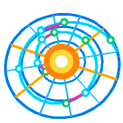

# BOINC Discord RPC

Real-time Discord Rich Presence (RPC) integration for **BOINC** distributed computing projects.
Automatically cycles through your active BOINC projects in your Discord status, displaying live task progress, elapsed computation time, total completed tasks count, animated artwork, and project links.

[](https://www.python.org/downloads/)
[](https://discord.com/)
[](https://boinc.berkeley.edu/)
[](https://www.microsoft.com/windows)
[](https://opensource.org/licenses/MIT)

## Supported Projects

### Astronomy & Astrophysics

<table>
<thead>
<tr>
<th width="104" align="center">Preview</th>
<th width="196" align="left">Project</th>
<th width="276" align="left">Discord Status</th>
<th width="260" align="left">Activity</th>
</tr>
</thead>
<tbody>
<tr>
<td align="center"></td>
<td><strong>MilkyWay@home</strong></td>
<td><code>Playing&nbsp;MilkyWay@home</code></td>
<td>N-Body Galaxy Simulation</td>
</tr>
<tr>
<td align="center"></td>
<td><strong>Einstein@Home</strong></td>
<td><code>Playing&nbsp;Einstein@Home</code></td>
<td>Pulsar &amp; Gravity Wave Search</td>
</tr>
<tr>
<td align="center"></td>
<td><strong>Universe@Home</strong></td>
<td><code>Playing&nbsp;Universe@Home</code></td>
<td>Binary Stars &amp; Black Holes</td>
</tr>
<tr>
<td align="center"></td>
<td><strong>Asteroids@home</strong></td>
<td><code>Playing&nbsp;Asteroids@home</code></td>
<td>3D Asteroid Shape Modeling</td>
</tr>
</tbody>
</table>

### Physics & Climate

<table>
<thead>
<tr>
<th width="104" align="center">Preview</th>
<th width="196" align="left">Project</th>
<th width="276" align="left">Discord Status</th>
<th width="260" align="left">Activity</th>
</tr>
</thead>
<tbody>
<tr>
<td align="center"></td>
<td><strong>LHC@home</strong></td>
<td><code>Playing&nbsp;LHC@home</code></td>
<td>CERN Particle Beam Physics</td>
</tr>
<tr>
<td align="center"></td>
<td><strong>Climateprediction.net</strong></td>
<td><code>Playing&nbsp;Climateprediction.net</code></td>
<td>Global Climate Modeling</td>
</tr>
</tbody>
</table>

### Biology & Medicine

<table>
<thead>
<tr>
<th width="104" align="center">Preview</th>
<th width="196" align="left">Project</th>
<th width="276" align="left">Discord Status</th>
<th width="260" align="left">Activity</th>
</tr>
</thead>
<tbody>
<tr>
<td align="center"></td>
<td><strong>Rosetta@home</strong></td>
<td><code>Playing&nbsp;Rosetta@home</code></td>
<td>3D Protein Folding &amp; Design</td>
</tr>
<tr>
<td align="center"></td>
<td><strong>World Community Grid</strong></td>
<td><code>Playing&nbsp;World&nbsp;Community&nbsp;Grid</code></td>
<td>Medical &amp; Humanitarian Research</td>
</tr>
</tbody>
</table>

### Mathematics

<table>
<thead>
<tr>
<th width="104" align="center">Preview</th>
<th width="196" align="left">Project</th>
<th width="276" align="left">Discord Status</th>
<th width="260" align="left">Activity</th>
</tr>
</thead>
<tbody>
<tr>
<td align="center"></td>
<td><strong>latinsquares</strong></td>
<td><code>Playing&nbsp;latinsquares</code></td>
<td>10x10 Latin Squares Search</td>
</tr>
<tr>
<td align="center"></td>
<td><strong>PrimeGrid</strong></td>
<td><code>Playing&nbsp;PrimeGrid</code></td>
<td>Record Prime Number Search</td>
</tr>
</tbody>
</table>

## Quick start

Requirements: **Windows**, **Python 3.8+**, running tasks in BOINC, and the Discord desktop app. No extra pip packages required.

1. Download `boinc-discord.zip` from [Releases](../../releases/latest) and extract it.
2. Run `start_discord.bat`.
3. A BOINC icon appears in your Windows system tray, and your Discord profile automatically updates and cycles across your active BOINC projects.

> If BOINC is installed as a Windows service, run `start_discord.bat` as administrator so `boinccmd` CLI can query task status.

## How it works

```
boinccmd --get_tasks -------------+
                                   |
job_log_*.txt (per project) ------+--> discord_rpc.py --Named Pipe (\\.\pipe\discord-ipc-*)--> Discord Desktop
                                   |
Standalone System Tray (tray.py) -+
```

- **Zero Dependencies**: `discord_rpc.py` communicates directly with the local Discord desktop client via Windows Named Pipes (`\\.\pipe\discord-ipc-0..9`), requiring zero third-party packages (`pypresence` not needed).
- **Cyclic Project Rotation**: Polls `boinccmd --get_tasks` for active (`EXECUTING`) projects. When multiple supported projects are running simultaneously, the status automatically rotates between them every **18 seconds** while refreshing live percentage progress every **4.5 seconds**.
- **Per-Project Sticky Workunit Tracking**: For each active project, automatically targets the workunit with the lowest progress and tracks it continuously through to 100% completion before switching to the next workunit.
- **Standalone System Tray**: Right-click the tray icon to switch between `Cyclic Rotation`, pinning a specific project via the `Pin Project` menu, or pausing/resuming Discord status.

## Options

```bash
# Silent background execution with system tray (default via start_discord.bat)
pythonw app.py

# Run in console with stdout logging
python app.py --console

# Custom progress update interval (seconds) and project rotation interval (seconds)
python app.py --interval 4.5 --rotate-interval 18.0

# Custom BOINC paths
python app.py --boinc-data "C:\Other\data.BOINC" --boinccmd "C:\Other\BOINC\boinccmd.exe"

# Headless mode (no system tray icon)
python app.py --no-tray
```

`boinccmd.exe` and the BOINC data directory are detected automatically.
For custom installations, use `--boinccmd <path>` and `--boinc-data <path>`.

## Safety

The service strictly uses standard read queries (`boinccmd --get_tasks` and reading `job_log_*.txt`) with zero memory writes or injections. All Discord communications take place locally via standard Win32 named pipes without external network requests. This project is independent and not affiliated with BOINC or Discord.

## License

Distributed under the MIT License. See [LICENSE](LICENSE) for details.
