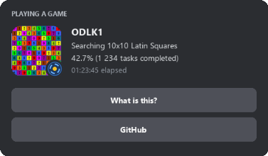

# ODLK1 Discord RPC

Real-time Discord Rich Presence (RPC) integration for **ODLK** BOINC tasks (diagonal Latin squares 10×10).
Displays live computation progress, elapsed time, total completed Latin square tasks count, and project links directly on your Discord profile.

[](https://github.com/nikolaevichsmor/odlk1-discord/actions/workflows/tests.yml)
[](https://www.python.org/downloads/)
[](https://discord.com/)
[](https://boinc.multi-pool.info/latinsquares/)
[](https://www.microsoft.com/windows)
[](https://opensource.org/licenses/MIT)



## Quick start

Requirements: **Windows**, **Python 3.8+**, running ODLK tasks (`odlk3` / `odlkmax` version 1.0) in BOINC, and the Discord desktop app. No extra pip packages required.

1. Download `odlk1-discord.zip` from [Releases](../../releases/latest) and extract it.
2. Run `start_discord.bat`.
3. An icon appears in your Windows system tray, and your Discord profile automatically updates with your active ODLK workunit progress.

> If BOINC is installed as a Windows service, run `start_discord.bat` as administrator so `boinccmd` CLI can query task status.

## How it works

```
boinccmd --get_tasks -------------+
                                   |
job_log_*.txt ---------------------+--> discord_rpc.py --Named Pipe (\\.\pipe\discord-ipc-*)--> Discord Desktop
                                   |
ODLK1 Voxel (optional) ------------+ (shared tray IPC)
```

- `discord_rpc.py` communicates directly with the local Discord desktop client via Windows Named Pipes (`\\.\pipe\discord-ipc-0..9`), requiring zero third-party dependencies (`pypresence` not needed).
- Periodically queries `boinccmd` for active executing ODLK tasks, calculates percentage and elapsed time, and counts all completed tasks from the BOINC job log.
- Automatically targets the workunit with the lowest progress and tracks it through to 100% completion before switching to the next task.
- Rate-limit friendly: updates every 4.5 seconds to strictly comply with Discord RPC rate limits.
- Auto-reconnection: automatically re-establishes named pipe connections if Discord is launched after the script, restarted, or during account switches.

## Status display layout

| Field | Content | Example |
|---|---|---|
| **Large Image** | Animated 10×10 ODLK1 Latin square matrix (`GIF`) | `ODLK1 Latin Squares` |
| **Small Image** | Animated BOINC corner badge (`GIF`) | `BOINC` |
| **Details** | Activity description | `Searching 10x10 Latin Squares` |
| **State** | Progress & total completed count | `42.7% (1 234 tasks completed)` |
| **Timestamp** | Elapsed computation time | `01:23:45 elapsed` |
| **Button 1** | Project information link | `What is this?` &rarr; Latin Squares project |
| **Button 2** | Source repository link | `GitHub` &rarr; `odlk1-discord` |

## System Tray Synergy

This presence monitor features native synergy with [odlk1-voxel](https://github.com/nikolaevichsmor/odlk1-voxel) (the real-time 3D voxel cube visualizer).

When both applications are running, they automatically link via local IPC and share a **single unified Windows system tray icon**, providing synchronized controls (pause/resume Discord status, pause/resume 3D visualizer, and exit) without duplicate tray icons cluttering your taskbar.

## Options

```bash
# Silent background execution with system tray (default via start_discord.bat)
pythonw app.py

# Run in console with stdout logging
python app.py --console

# Custom update interval or BOINC paths
python app.py --interval 5.0 --boinc-data "C:\Other\data.BOINC" --boinccmd "C:\Other\BOINC\boinccmd.exe"

# Headless mode (no system tray icon)
python app.py --no-tray
```

`boinccmd.exe` and the BOINC data directory are detected automatically.
For custom installations, use `--boinccmd <path>` and `--boinc-data <path>`.

## Safety

The Discord RPC service strictly uses standard read queries (`boinccmd --get_tasks` and reading `job_log_*.txt`) with zero memory writes or injections. All Discord communications take place locally via standard Win32 named pipes without external network requests. This project is independent and not affiliated with ODLK, BOINC, or Discord.

## License

MIT. Three.js is MIT (see `web/vendor/LICENSE-three.txt`).
